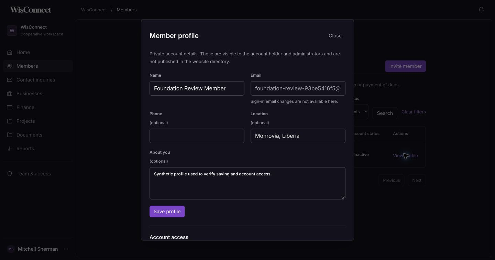
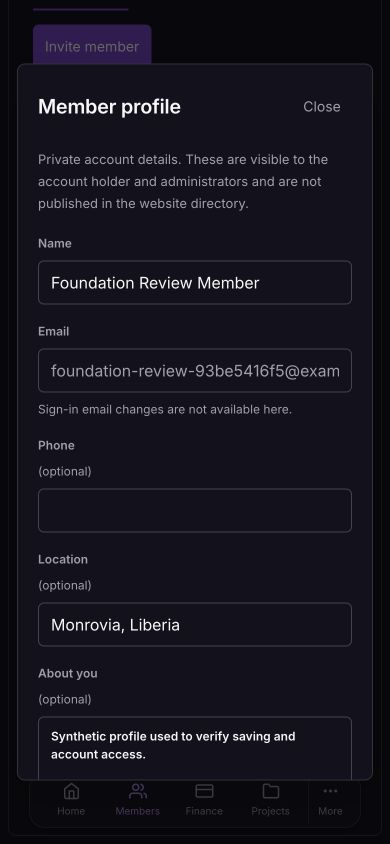

# Account foundation and member-management review

12 October 2026. Implemented locally for Mitchell's requested foundation/member-management pass. Not committed, pushed or publicly enabled.

## What was already working

The local FastAPI/PostgreSQL pilot had scrypt password hashing, hashed session/invitation tokens, single-use invitation acceptance, administrator/member authorization, origin protection, login throttling, profile-name editing, logout, contact inquiries and newsletter intake. The existing authentication integration suite passed before changes.

## Gaps addressed

| Finding | Change |
| --- | --- |
| Development database and captured emails were in temporary directories. | Preserved the original cluster/inbox, backed up the database, copied vendor runtimes and relocated active data into ignored `.local/` storage. Added `local:up`, `local:check` and `db:backup`; Docker Mailpit now also uses a named volume. |
| No password recovery. | Request/reset page and API with generic account responses, 30-minute hashed tokens, single use, replacement of earlier links, throttling and session revocation. Email is captured locally only. |
| Accounts exposed only name/email and deletion in the directory. | Private profile editor for name, optional phone, location and biography; server-side paginated search and active/inactive filters. |
| No reversible way to suspend access. | Administrator-only deactivation/reactivation for member accounts, with explicit confirmation, retained records and immediate session/recovery-token invalidation. Administrator access is protected. |
| No protection against stale profile edits. | Version checks reject conflicting changes with HTTP 409 and a visible reload action. |
| No record of profile/access/recovery changes. | Account activity records, visible to administrators in the profile. No password/token content or prior private field values stored in activity. |
| First-admin setup could race. | PostgreSQL transaction advisory lock serializes bootstrap attempts. |
| A login could overlap deactivation or password recovery. | Account row locking serializes login session creation with access/password changes. |

Self-service profile APIs identify the user from the session, never a submitted account ID. Admin detail/edit/access APIs require administrator authorization; submitted role/email/status extras cannot escalate profile access. The existing name-only and member-delete APIs remain compatible; routine dashboard management now uses reversible access controls. Profile details are not published or interpreted as membership approval or dues status.

## Verification

- Existing authentication suite passed before implementation.
- `npm run foundation:check`: owned PostgreSQL schema; private/self/admin permissions, validation, directory search/pagination, literal wildcard handling, stale/concurrent updates, access revocation/reactivation, preserved profiles, password reset expiry/reuse/concurrent redemption, SMTP rollback, generic responses, rate limits and activity records.
- `npm run auth:check`, `npm run contact:check`, `npm run newsletter:check`, and `node scripts/python.mjs -m backend.check_bootstrap` passed after the changes.
- Production build/static export and TypeScript passed with the new recovery route (16 routes).
- Chrome checks: real administrator session, synthetic member profile edit/save/reopen, inactive state, server search/filter, activity records, bounded phone dialog and Escape/focus return; 390px layout without document overflow. Dark-theme form/select issues found and corrected. Generic recovery request feedback verified in Chrome. No real password was changed during browser checks; reset mutation/security checks used isolated test accounts via the integration suite.
- In-app browser requests to the local API reported a connection error; the form retained the address and displayed its failure state. Chrome successfully completed the same request. This local browser transport limitation remains separate from the API tests.
- `local:up` and `local:check` passed with persistent storage, current migrations and healthy API/inbox/website. The private backup was restored to an isolated database; schema and administrator presence verified; only that disposable database was removed.
- Browser fixture and its synthetic activity removed. Mitchell's administrator account and existing application records preserved. No external emails, production deployment or changes to membership policy.

## What remains

Production API/database hosting, real email sender configuration, HTTPS identity settings, shared throttling and off-machine backup automation remain. Native startup was exercised on this machine; the revised Docker volume configuration was reviewed but not run because Docker is unavailable. Sign-in email/role management, application approval, membership status/dues, business records and the remaining operational screens require separate work. The local database is durable across restarts but its private backups still need copying to protected off-machine storage before production use.

