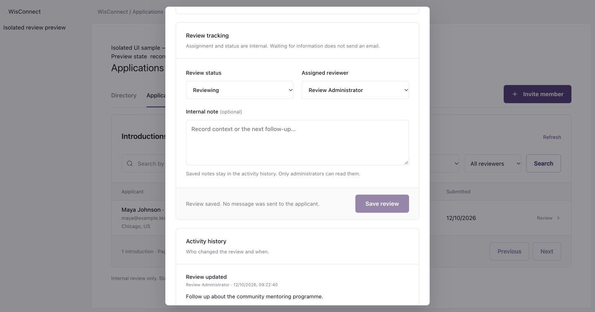
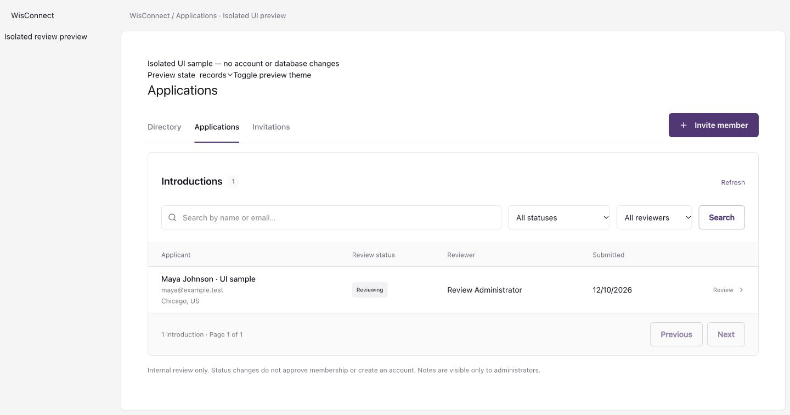
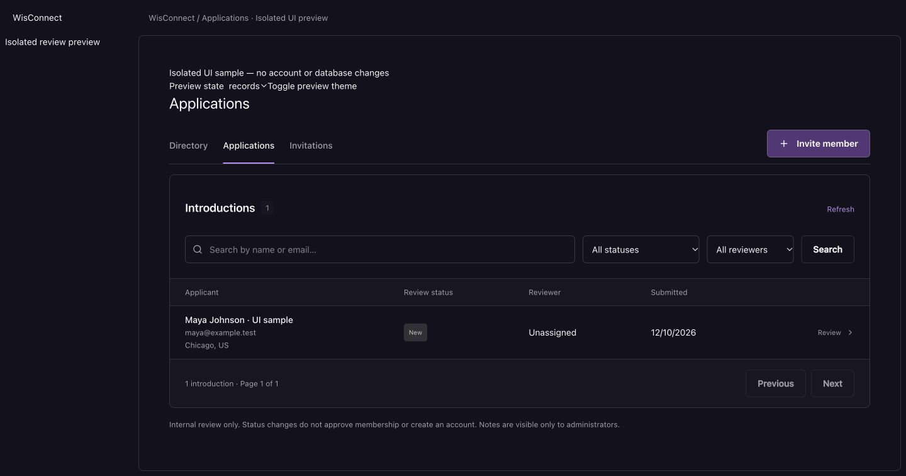
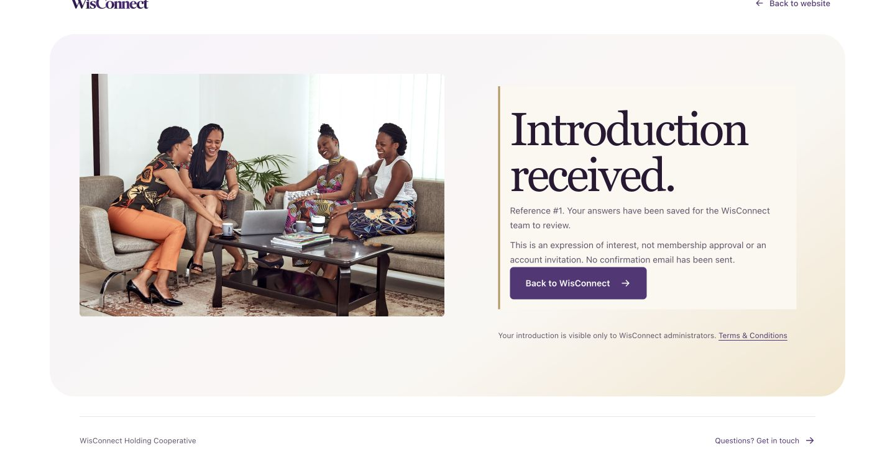

# Applications — saved introductions and private review

12 October 2026. Local implementation; no deployment.

## Scope

- Persist the local Join form’s five answers, submission time and reference. Safe repeat submissions reuse a UUID. Public/static email fallback remains.
- Administrator-only list/detail/reviewer/activity/update endpoints. Name/email search, review status and assignment filters, 25-record pages.
- New, Reviewing and Waiting for information; active-administrator assignment; append-only internal notes; actor/date/change history. No membership approval, rejection, eligibility, dues, invitation or email behavior.
- Row locks, versions and review request UUIDs prevent silent overwrites and duplicate notes. UI offers reload while retaining unsaved notes, plus unsaved-close confirmation.
- Consistent workspace frames, restrained purple controls, skeleton/empty/error states, light/dark and phone layouts.

## Verification

- `npm run applications:check`: isolated PostgreSQL schema, real HTTP requests; validation, private responses, session/admin boundaries, active-reviewer validation, literal-wildcard search, filtering, intake/review idempotency, simultaneous writes, list/history pagination, Unicode answers and throttling. Schema cleaned up.
- `npm run foundation:check` and `npm run auth:check`: passed existing regression suites.
- `npm run build`, `npm run typecheck`, `git diff --check`: passed.
- Live browser Join: required-answer errors; all five synthetic answers; review; receipt #1. Database verified answers/status/initial activity, then removed only exact synthetic record. No applicant email or account creation.
- Administrator browser session was signed out. Review UI used a temporary in-memory sample route: save/notice/history, conflict/error/reload with note preserved, unsaved-close warning, empty/error/retry/loading. Actual server permissions and writes were exercised by isolated API tests. Preview removed before final build.
- Desktop light/dark; phone 390px and 320px; no horizontal overflow at 320px (dialog 284px client and scroll widths). Corrected mobile filters and reviewer alignment.

## Screenshots (synthetic records)

## Local operations and limits

Migration 0005 applied after a local backup. Existing uncommitted repository work retained. All data and authentication remain on the existing localhost-only pilot. Public deployment needs hosted API/database/auth infrastructure; membership policy remains awaiting WisConnect.
