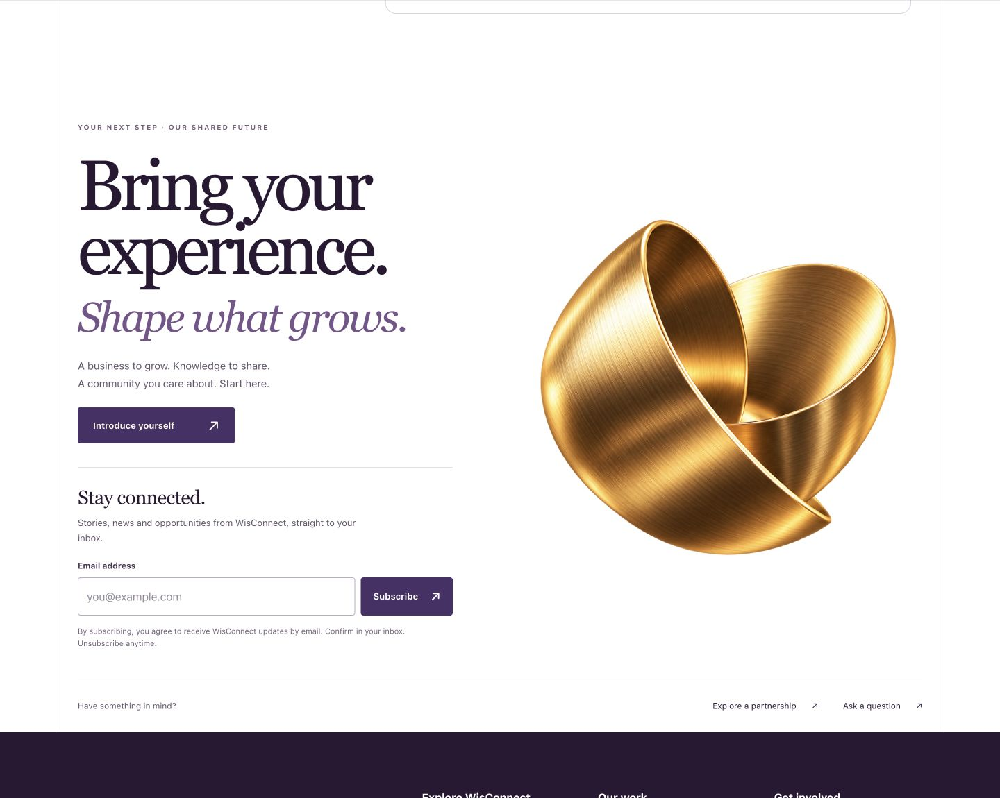
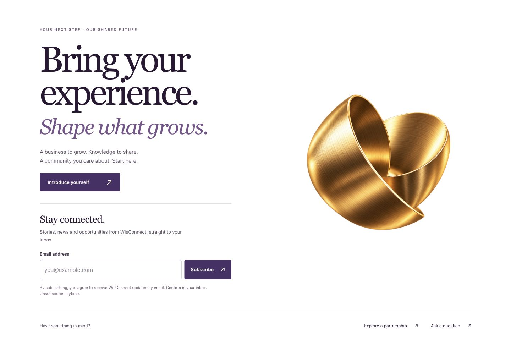
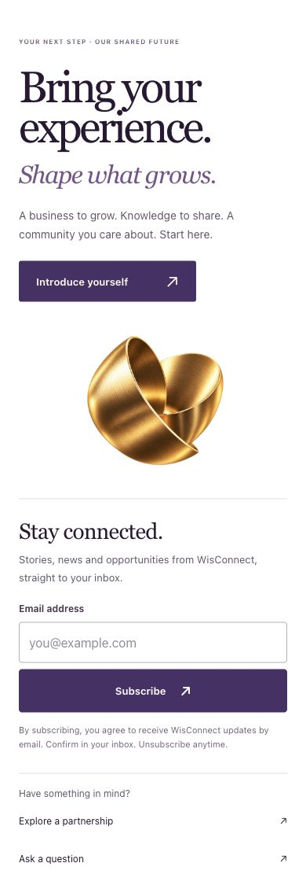
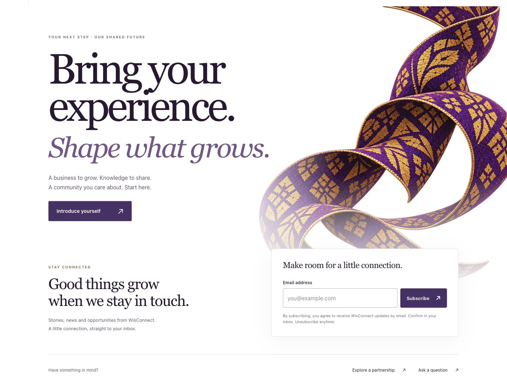
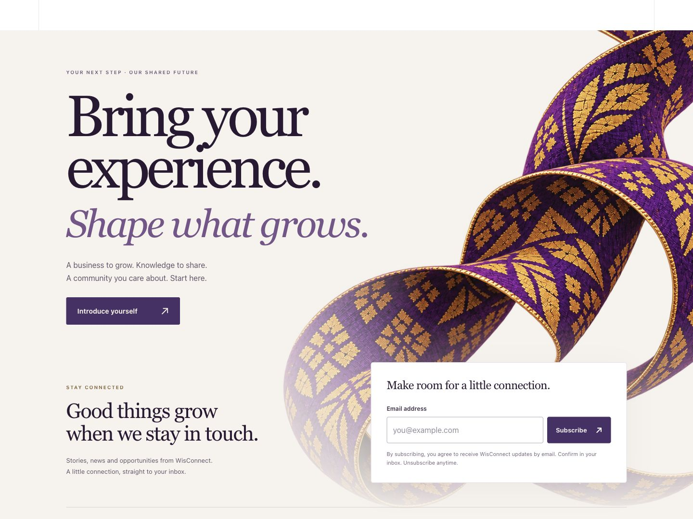
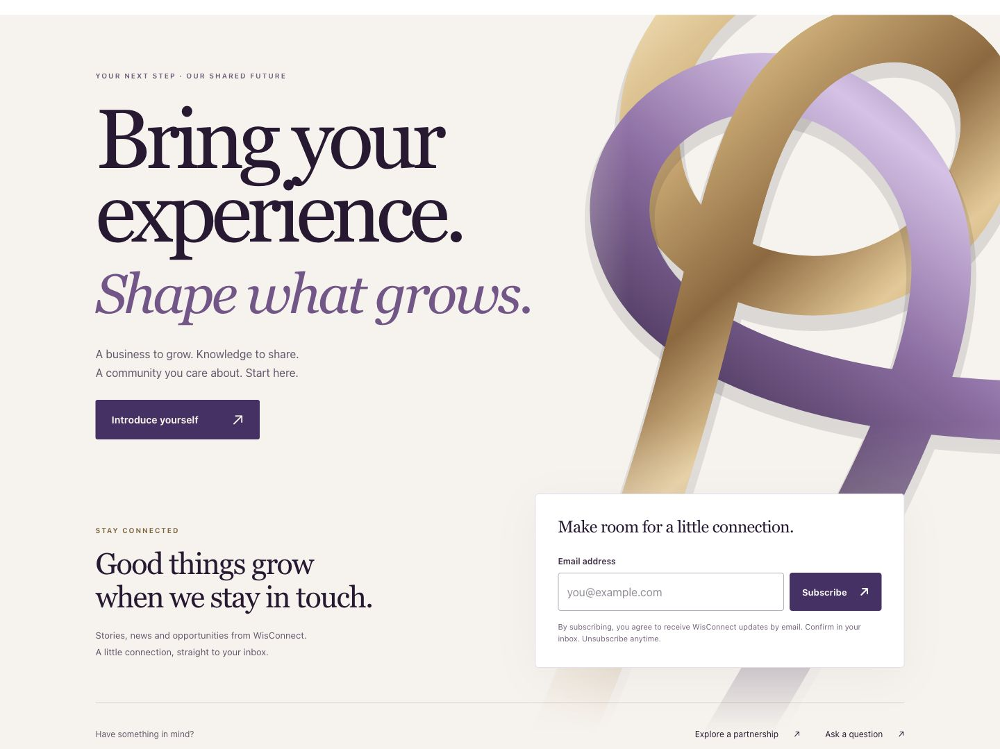
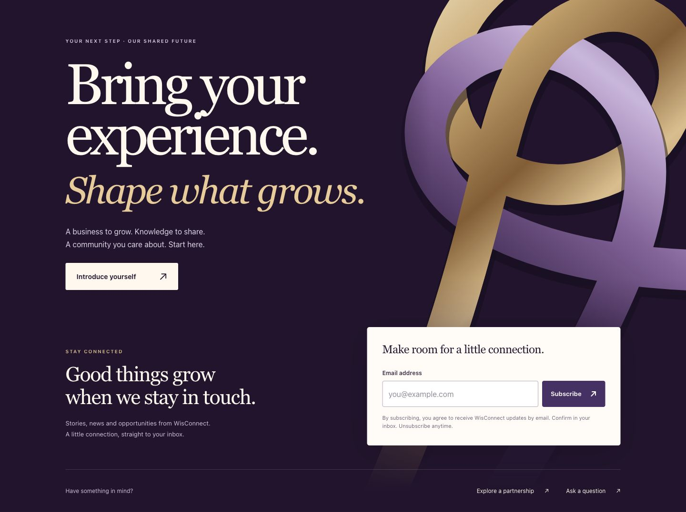
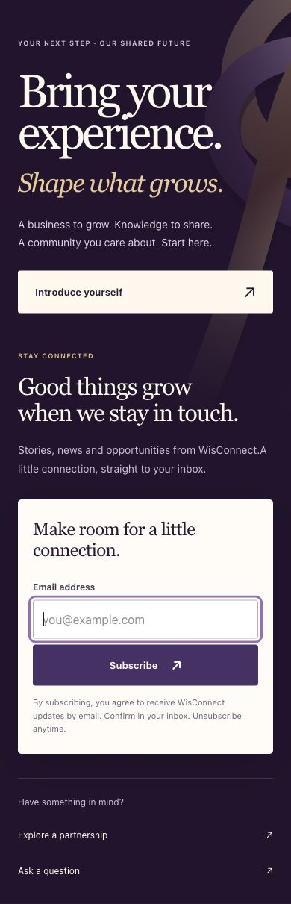
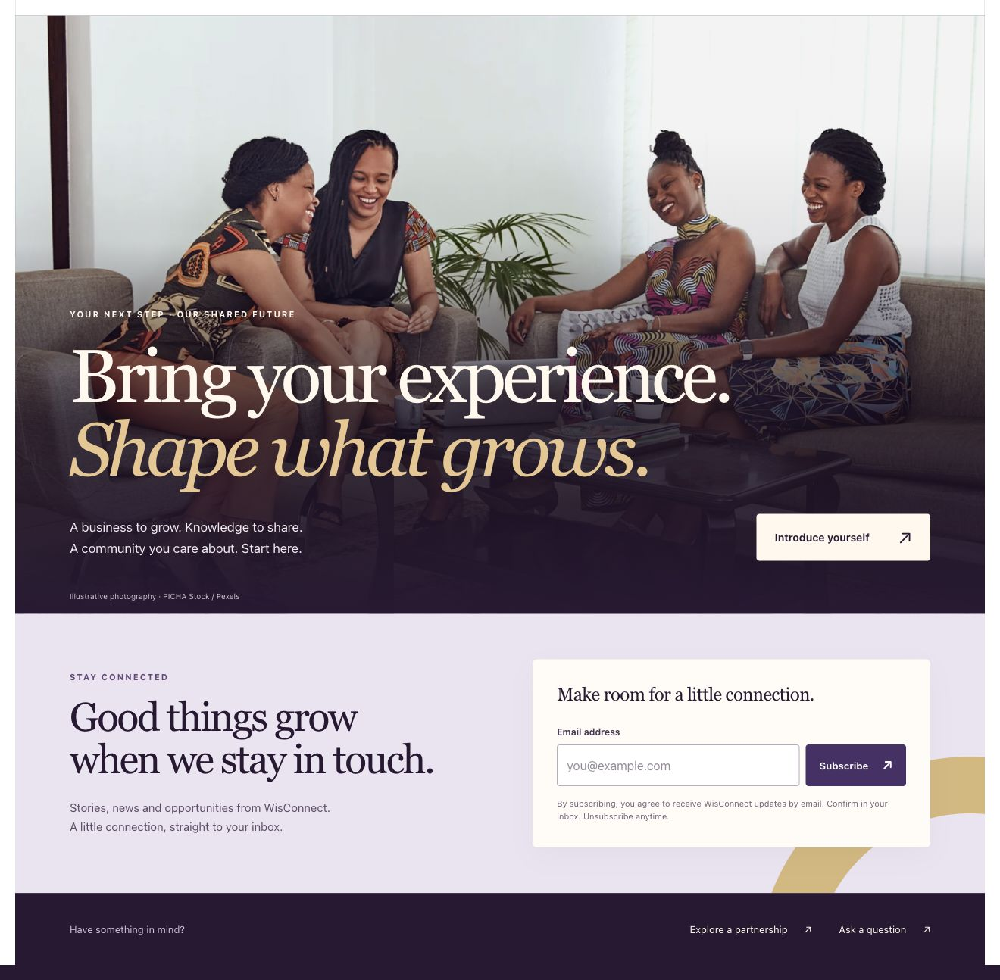
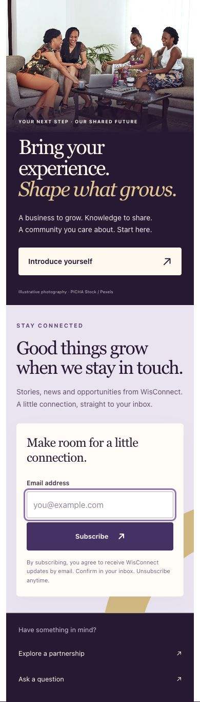

# Release approval — 12 October 2026

Mitchell approved the balanced gold ribbon and continuous rails and requested a push. Final production build/static export of all 15 routes passed. Public signup remains coming soon until production email/API hosting is configured. The entries below preserve the local design and test history.

## Current refinement — balanced artwork and rails

Larger intact gold artwork, tighter desktop column spacing and continuous existing page rails. White surface, signup behavior and phone layout retained. Desktop visual check and 1100/390px overflow checks passed. Local only.

## Current preview — gold ribbon, 12 October 2026

Supplied gold sculpture shown whole on white; compact left-column invitation and integrated signup replace the separate card and secondary heading. Desktop and 390px phone visual checks passed, with no phone horizontal overflow. TypeScript passed. Backend unchanged. Local only.

# Your next step — A + F implementation

12 October 2026. Local review; not committed, pushed or deployed.

## Current: clean white, smaller textile

Mitchell explicitly selected clean white after rejecting the ivory background and finding the textile too large. The desktop image is now 880px instead of 1180px; mobile/tablet sizes and offsets were reduced too. Layout and signup functionality remain. Desktop/mobile visual fitting and whitespace checked.

## Latest artwork: supplied textile

Replaced the SVG with Mitchell’s transparent `0E72EE35-7D16-4212-AE45-008C1F8B6532.PNG`. After his clarification, enlarged it to flow off the section edges and behind the signup like the previous ribbons. No image pixels were edited; CSS handles size, crop and subtle fading. The warm ivory palette remains. Desktop/mobile image loading, fitting, TypeScript and whitespace checks passed. Newsletter behavior unchanged.

## Latest palette: warm ivory

Mitchell approved the ribbons/full-width composition and requested a lighter background. Changed to warm ivory, plum type, muted purple emphasis, a plum primary action and a white signup panel; reduced ribbon shadow opacity. Layout and signup logic unchanged. Desktop/mobile visually checked; whitespace check passed.

Earlier versions below are retained as history.

## Revision after review: full-width graphic background

Mitchell rejected the inset image and repeated photography. Replaced them with a continuous full-width plum surface and original SVG ribbons in gold and lilac. The section covers the fixed rails locally; the rest of the page keeps its rails. Removed the photo and separate lilac band, retaining the membership and contact paths and existing email signup behavior. No backend changes.

Reviewed at 1440/760/390/320px, including keyboard focus and form fitting. No horizontal document overflow. Production static export and TypeScript passed. The mobile ribbon treatment is intentionally quieter behind the text. No animations or new downloaded images.

The original photographic implementation and its verification are retained below as history; the screenshots below are superseded.

## Design

Replaced the three closing cards with a large photographic invitation, oversized cream/gold headline, a prominent membership action, a lilac signup band and a cream email panel. Partnership and question links remain beneath it. Uses the existing licensed PICHA Stock/Pexels community photograph with an illustrative credit. Mobile preserves all four faces and stacks the email control above its button. The section follows the site’s existing rails and retains `#join`.

## Verification

- Production static export: all 15 routes, including `/newsletter`, passed. TypeScript and `git diff --check` passed.
- PostgreSQL newsletter integration suite passed: real migration, normalized unique addresses, simultaneous requests and one email, consent/validation, bad origin/large body, administrator authorization, pending addresses excluded from active list, hashed tokens, simultaneous single-use confirmation, expiry, unsubscribe/repeated unsubscribe, resubscribe, SMTP failure/retry and rate limiting.
- Existing PostgreSQL contact and authentication suites passed after the new migration/router was added. Suites used disposable schemas and cleaned only owned Mailpit messages.
- Chrome: real synthetic signup → captured Mailpit email → confirm → success → unsubscribe → success. Addresses remain visible after a connection failure. Confirm/unsubscribe are explicit user actions, not GET side effects. Same-page email hash changes are handled; successful actions remove the token from the address bar.
- Responsive review at 1440, 760, 390 and 320 CSS pixels. No horizontal document overflow. Mobile focus no longer scrolls the decorative container; `overflow: clip` prevents an offscreen gold arc creating a hidden scroll area. Keyboard Tab reaches Subscribe with visible focus.
- The inactive-origin guard was checked using 127.0.0.1:3000: signup disabled, coming-soon text visible. The hosted base-path guard remains in code. No remote deployment or real SMTP delivery was attempted.
- The in-app browser rendered the design and failure state correctly but did not complete cross-origin API requests in this environment. Full subscription behavior was verified in Chrome. No browser security restrictions were disabled to bypass this.

The single synthetic browser subscriber and its local mail were removed after checking. The temporary PostgreSQL/Mailpit preview services remain running for review. Operational setup and hosting requirements are in `docs/design/newsletter-service.md`. Existing sector-card work is preserved.
