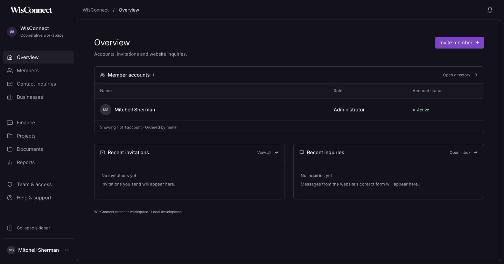
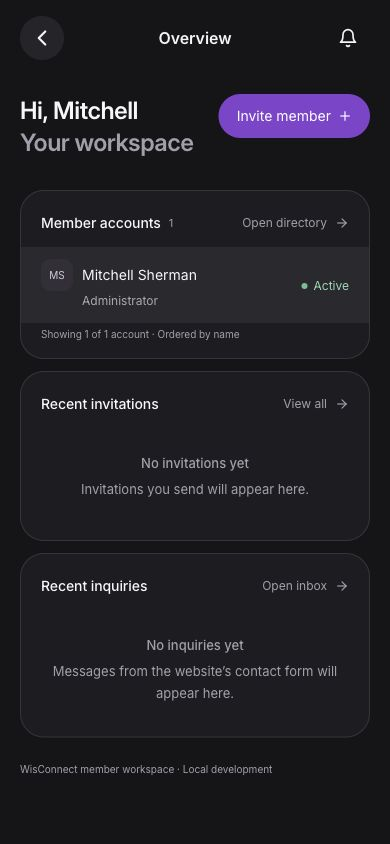
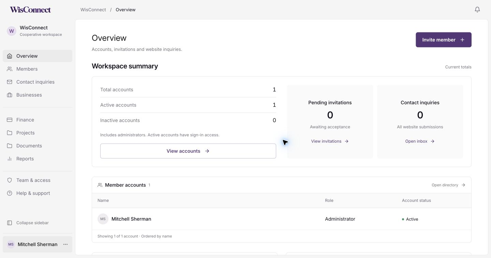
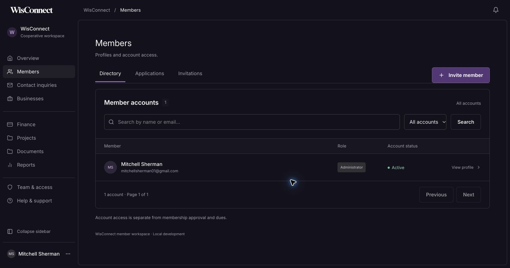
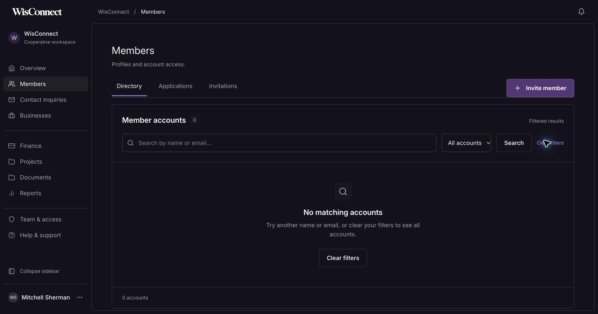
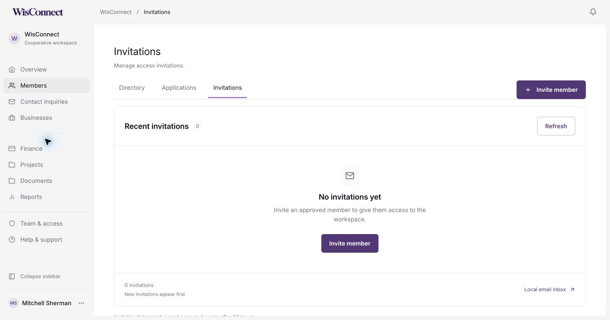
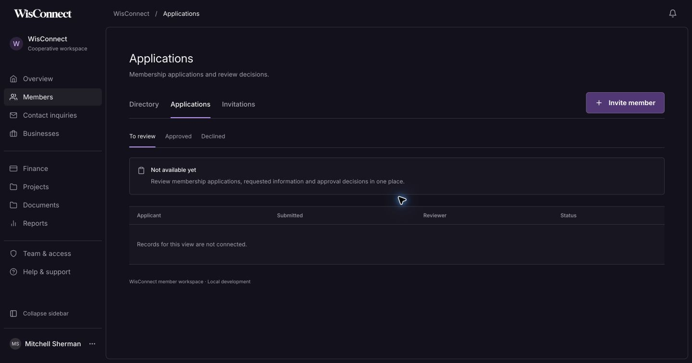
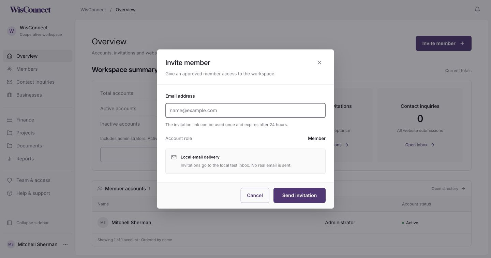
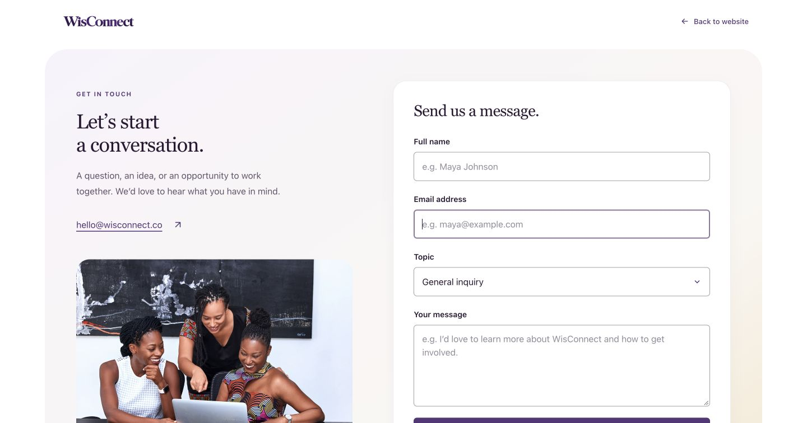
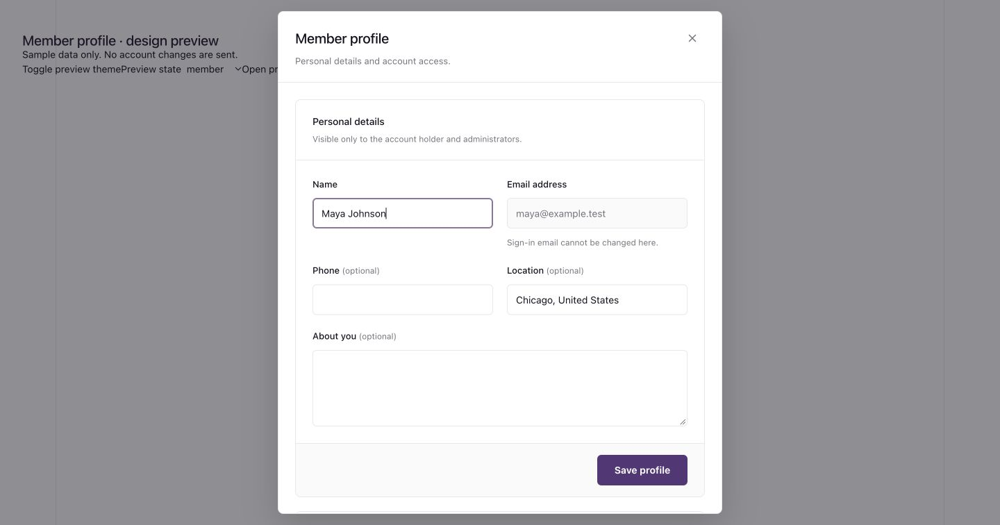

# Railway desktop and Link mobile workspace

12 October 2026. Local implementation for visual review; not pushed.

Mitchell rejected the preceding workspace treatment and chose two specific references. Inspected the actual authenticated pages through his available tabs:

- [Railway dashboard](https://railway.com/dashboard): workspace shell, expanded/collapsed navigation, page spacing and People records.
- [Link](https://app.link.com/): phone home layout and full-page account menu.

Only interface patterns were used. Source account records and screenshots were not copied into the repository.

## Changes

Desktop follows Railway’s measured 220px expanded / 56px collapsed navigation, 56px context header, 8px workspace corners, thin border and 48px content padding on wide screens. Headings use normal-weight 24px type; primary controls retain purple. Light and dark variants remain available.

Mobile follows Link’s centered header, circular navigation control, 24px greeting, grouped rounded records and full-page account menu with a 56px identity avatar and 52px navigation rows. Replaces the floating bottom navigation. WisConnect’s own logo, content, roles and actions remain.

The overview still loads actual account, invitation and inquiry data. Member search, filters, profile access, invitations and account controls preserve the existing APIs. Unavailable operational sections still explain their current status. No new backend functionality, fabricated data or external account changes.

## Verification

- Production build, TypeScript and static export of all 16 routes.
- Desktop shell, collapse/expand and icon-rail labels checked in Chrome at 1440px.
- Phone overview and member directory checked at 390px and 320px; no horizontal overflow.
- Full-page navigation opens, focuses Close, selects Members and restores heading focus. Escape returns focus to its opener. Resizing to desktop closes the dialog.
- Member profile opens and closes; directory action receives focus afterward. No profile data changed.
- Mobile notifications align below the header and preserve page scroll (scrollY remains 0).
- Whitespace validation passed. Browser viewport overrides restored.

## Previews

## Follow-up: Railway Usage statistics

The overview summary now follows the specifically requested [Railway Usage](https://railway.com/workspace/usage) screen: 24px framed panel, 32px grid gap, divided account rows and paired shaded totals with 6px corners. It displays WisConnect’s real account breakdown and invitation/inquiry counts. Phone layout stacks the groups. Buttons retain homepage branding. Build/static export passed; desktop and 390px visually reviewed.

## Follow-up: Members directory and states

Members now uses a single framed panel containing padded filters, record rows and pagination. Skeleton rows mirror the directory on desktop and phones. Empty messages distinguish no accounts, filtered results and an empty later page, with appropriate recovery actions; errors retain retry. Search reset and profile-close focus behavior were checked with real local data. Desktop/390px visual checks and 320px overflow passed. Loading and first-account empty components were visually checked with a temporary local preview, which was removed before the successful production export.

## Follow-up: Invitations and request states

Invitations now shares the Members toolbar, panel and record spacing. It includes recipient icons, readable status labels, explicit expiry dates, refresh and the local email inbox link. Counts describe recent invitations, respecting the existing 50-record endpoint limit. Loading rows follow the real table/card anatomy; empty and error states use the same panel and action styling.

Checked real empty-state invitation dialog open/cancel/focus restoration, desktop/mobile layouts and 320px overflow. An isolated temporary UI preview exercised populated rows, loading, errors and simulated revocation feedback/focus without changing real invitations. The preview route was removed before the production build.

## Follow-up: Shared member navigation

Directory, Applications and Invitations now render one shared navigation/action component in the dashboard shell. This removes Applications’ separate header action and older navigation styling, plus the duplicated Directory/Invitations toolbars. Tab spacing, label weight, active underline and the leading-plus Invite member button remain consistent when switching views. Phone layouts stack the action below the tabs.

Production build/static export, TypeScript and whitespace validation passed. Desktop switching and 390px mobile layout checked without overflow. Applications remains a preview; no invitations or account data changed.

## Follow-up: Invite member form

The invite dialog now shares the workspace's divided header, neutral panel surfaces, compact typography and action footer. Member role is a read-only summary row. Delivery information, sending, error and confirmation states stay within that frame. Done receives focus after success; closing restores the opener.

Mitchell subsequently requested removing coloured form outlines. Fields now use neutral default/focus borders, with focus drawn inside the control. This covers dashboard forms, account entry/reset forms, contact, join and newsletter. Branded buttons retain their fills.

Checked desktop light/dark, 320px mobile, native required-email validation and focus restoration. Simulated request states were verified in an isolated temporary route, removed after review; no real invitations were sent.

## Follow-up: Subtle brand accents

Mitchell clarified that a little purple is desirable. Focused fields now use a shared muted purple border, staying thin and inset; resting borders remain neutral. Dark dashboard fields use a lighter muted variant. This replaces the entirely neutral focus treatment above without restoring the large outer rings.

## Follow-up: Member profile form

Member profiles now use the invite form's divided header, compact typography, consistent fields and shaded action footer. Optional labels stay inline, email remains read-only, and the biography spans the form. Account access and activity sit in separate framed sections. This also updates the shared profile editor in Account settings.

Loading follows the field layout; saving includes a spinner and live status; errors stay inside the form with reload recovery. Save focus is restored after completion. Existing account APIs, optimistic version checks and administrator restrictions remain in place.

The local workspace was signed out, so visual and state checks used an isolated preview with sample data: light/dark, 390px/320px, loading, save success/error, load error and read-only administrator behavior. No real account changes were made. The temporary route was removed after verification.

