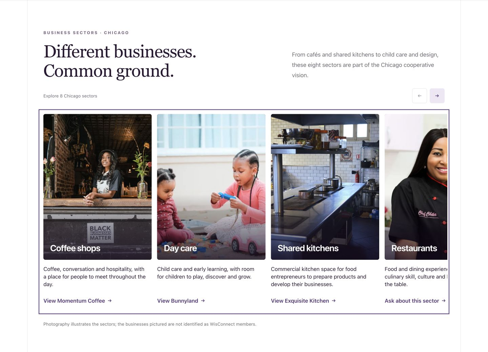
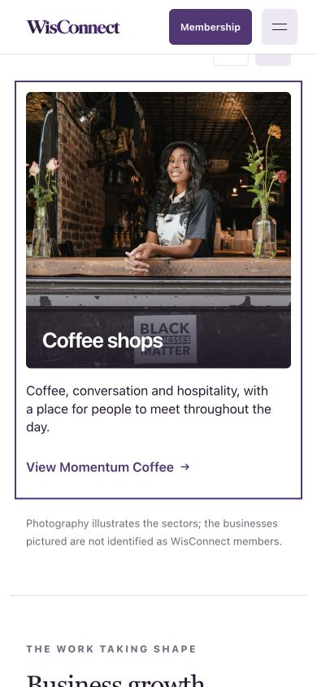

# Sector card destinations — 12 October 2026

## Changes

| Chicago sector | Destination |
| --- | --- |
| Coffee shops | Momentum Coffee directory tile |
| Day care | Bunnyland directory tile |
| Shared kitchens | Exquisite Kitchen directory tile |
| Restaurants | Sector-specific contact inquiry |
| Wellness | Sector-specific contact inquiry |
| Juice bars | Sector-specific contact inquiry |
| Clothing stores | Sector-specific contact inquiry |
| Screen printing | Sector-specific contact inquiry |

All cards previously linked to membership introduction. Business links now name the destination, reveal and highlight the relevant tile, clear conflicting filters and move keyboard focus there. Existing details dialogs remain one activation away.

The directory descriptions do not verify Chicago businesses in the remaining five categories. Exquisite Catering is a caterer, BDavis describes design/apparel production, and Jennima’s Juice is in Liberia. Related services are not silently presented as exact matches. No imagery or business descriptions changed.

Inquiry links prefill the contact topic/message and the hosted email fallback. Only one of the eight known sector values is accepted. No message was submitted or email sent.

## Verification

- `npm run build`: passed, all 14 routes statically exported.
- `npm run typecheck`: passed.
- `git diff --check`: passed.
- Browser: all three links reached the correct focused tile and opened the matching business details; a repeat Shared kitchens link restored a listing hidden by a search filter, including when the hash was unchanged.
- Static production preview: all eight hrefs correct; all five inquiry links rendered the correct sector message and email subject/body. Plain contact retained General inquiry, an empty message and its generic email link.
- Layouts checked at 1440, 390 and 320px; no horizontal page overflow at phone widths. Carousel arrow/keyboard controls and pointer swipe still worked; swiping did not navigate. Mobile Coffee shops reached Momentum details; mobile Wellness retained the correct inquiry.
- Hosted submission availability remains unchanged; this pass does not deploy the contact backend.

## Screenshots

Local review only. Not committed, pushed or deployed.
