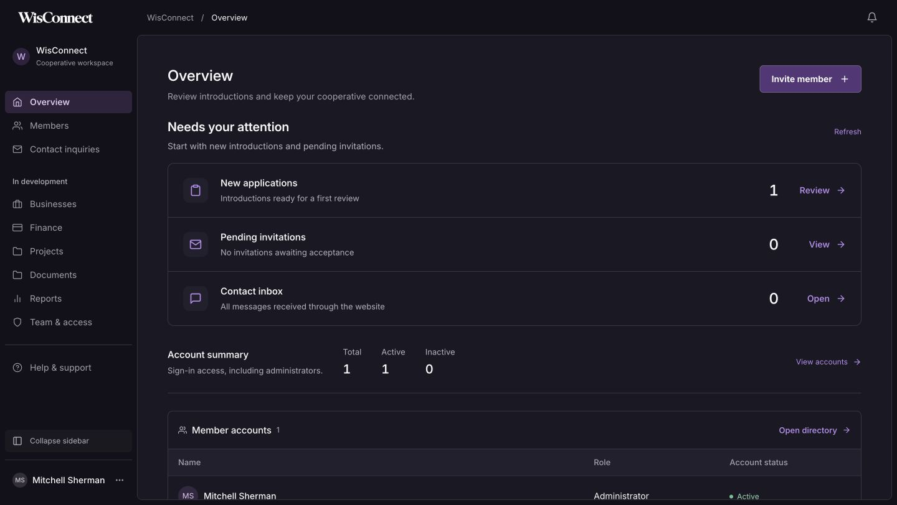
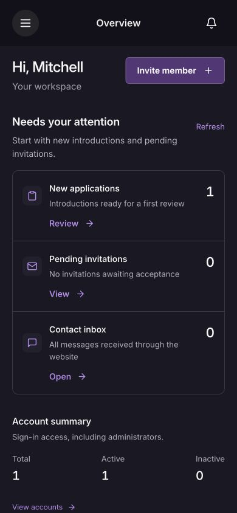
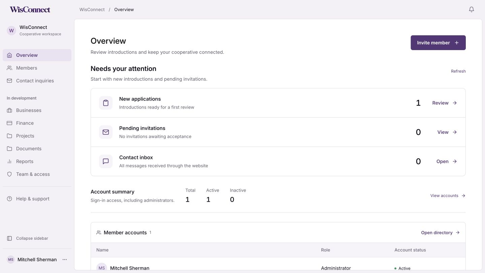

# Dashboard refinement — 13 October 2026

Approved refinement of the existing Railway desktop / Link mobile direction, guided by the apple-design skill’s hierarchy, familiarity and readability principles.

- Attention section replaces the oversized statistics panel. New applications uses the existing status=new endpoint; its shortcut opens that filtered list. Pending invitations and total contact submissions retain existing data sources. Account totals are compact and distinguish sign-in access from membership standing.
- Larger secondary labels and record actions; slightly brighter dark-theme text; subtle surface separation and purple selected states. Existing identities and content remain intact.
- Development destinations grouped in desktop/mobile navigation; mobile menu icon replaces misleading back arrow. Account settings remains separate.

## Verification

LAN-origin production export and TypeScript passed; git diff --check passed. Chrome checked desktop light/dark, 390px and 320px layouts, new-application count versus filtered list, All statuses on normal navigation, invitation/inbox shortcuts, menu grouping, close/focus return and no console errors/warnings. No real records or messages changed. Existing synthetic introduction remains untouched. Dark theme and viewport restored.

Loading/error handling was reviewed in code and loading was observed; a service outage was not simulated. Backend auth regressions were not rerun because the backend and permissions were unchanged. The new request remains behind the existing admin guard. Local only; no commit/push/deployment.

