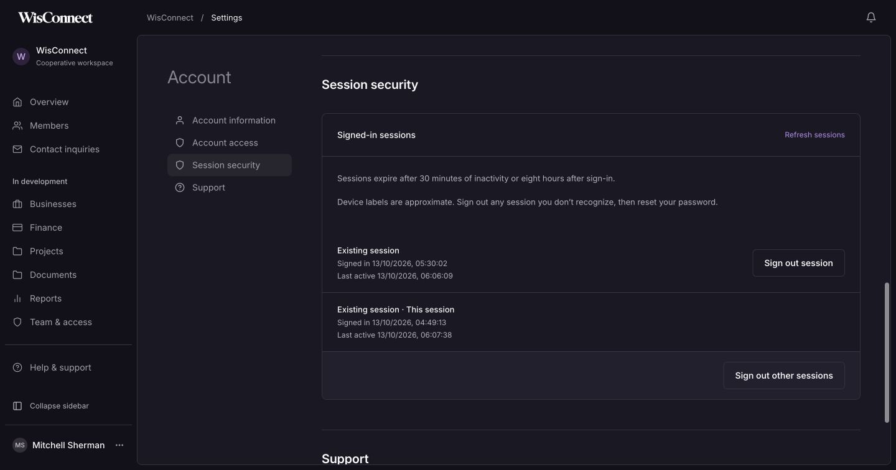
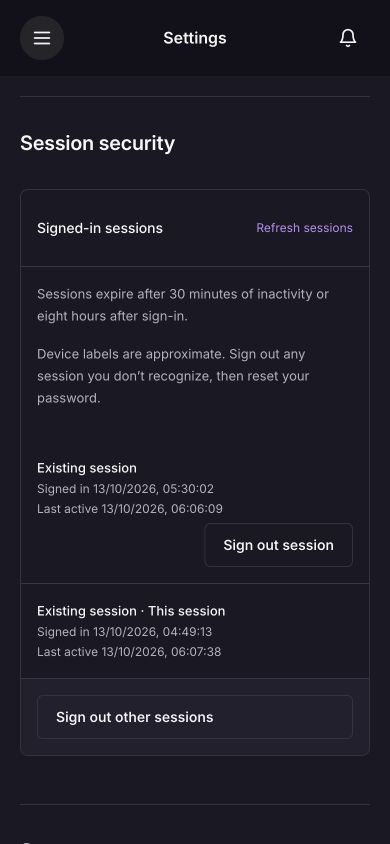

# Session security and account controls

13 October 2026. Local implementation in the active admin goal. Railway is the chosen future backend host; Mitchell explicitly deferred hosting setup and deployment. No hosted service was created or configured.

## Behavior

Account settings now contains Session security with the account holder's active sessions, approximate browser/device labels, sign-in time, last activity and a current-session marker. An account holder can sign out one other session or all other sessions. The current session is preserved; the existing Sign out action ends it. Both administrator and member accounts can manage their own sessions; administrators cannot use these endpoints to inspect or revoke another account's sessions.

Authenticated requests expire after 30 minutes without authenticated API activity, even if the browser still has its cookie. Activity updates do not extend the original eight-hour absolute expiry. Updates are conditional on unexpired, still-existing sessions and active users; revoked sessions cannot be recreated by an activity update. The UI does not simulate expiry locally or send keep-alive requests. Existing page focus checks can count as authenticated activity.

New sign-ins retain at most ten sessions per account, removing the oldest when needed. Coarse client labels are derived from an allowlist of browser/OS markers and are explicitly approximate. Raw user-agent strings, IP addresses and locations are not stored for this feature. Display IDs are random UUIDs separate from authentication tokens and token hashes. The response never exposes those credentials.

Sign-in, sign-out, individual session revocation and bulk revocation create account activity records. This improves existing history; it does not complete the broader security-logging milestone. MFA, sensitive-action reauthentication and account recovery for MFA remain pending.

## Migration and rollout

Migration `0007_session_management` adds session display IDs, created/last-seen timestamps and a coarse client label. Existing tokens, user links and absolute expiry are retained. Since legacy sessions did not record activity, their idle timer starts at migration; their original absolute expiry still applies. Legacy sign-in time is inferred from the existing fixed eight-hour lifetime, and their device label is “Existing session.”

Private backup before local migration: `.local/backups/20261013T125955575490Z.dump`. Migration applied successfully. The previously verified private preview worker was stopped and replaced after migration; the same database and account cookies remain in use. No existing account/password/application records were changed or real sessions deliberately revoked during testing. Authenticated browser inspection updates its ordinary session activity.

## Verification

- `npm run sessions:check` passed in an owned disposable schema. It starts at migration 0006 with a legacy token, applies 0007 and checks preservation, own-account isolation, safe IDs/fields, member/admin behavior, idle and absolute expiry, activity refresh, individual/bulk/concurrent revocation, origin protection, ten-session cap, coarse labels and audit events.
- `npm run auth:check` and `npm run foundation:check` passed with the new session dependency, covering invitations, active/inactive access, logout, password recovery, access revocation, reset concurrency, mail rollback and private account editing.
- A temporary UI fixture exercised loading, pending and success feedback, both confirmation paths, cancellation, error display and recovery. Keyboard focus moves to Cancel when confirmation opens and returns to Refresh afterward. At 320px, document width equaled viewport width. All fixture actions were simulated and touched no real session. Fixture source and its temporary dev server were removed before the final build.
- Final production LAN-origin export and TypeScript passed with all 16 normal routes and no sample route. `git diff --check` passed.
- Actual authenticated settings screen displayed both existing sessions with the correct current-session marker; no revocation controls were submitted on real data. Desktop and 390px rendering checked, with no browser console warnings/errors. The 320px check found no horizontal overflow. Corrected account-section anchor spacing so the fixed phone header no longer hides the heading; final 390px heading top was 129px below the viewport top. User's dark theme and normal viewport restored.
- The actual administrator browser session remained authenticated after backend restart. No password or new account was required.

## Remaining limits

Server-side idle expiry does not immediately blank a dashboard already open without making a request. The next authenticated request is rejected, and the existing focus/session check returns the user to sign-in. Form components retain their normal request-error handling. Immediate cross-tab notification and a proactive expiry warning can be added later; neither substitutes for server enforcement.

Session revocation affects subsequent requests; an already-authorized in-flight operation is not retroactively canceled. Per-account revocation is throttled. The local pilot still uses HTTP cookies restricted by the local/LAN boundary; hosted HTTPS/Secure-cookie configuration is separate work, deferred with hosting.

The expiry and session-management approach follows [OWASP session management guidance](https://cheatsheetseries.owasp.org/cheatsheets/Session_Management_Cheat_Sheet.html). This check does not claim an independent security audit or production readiness.
